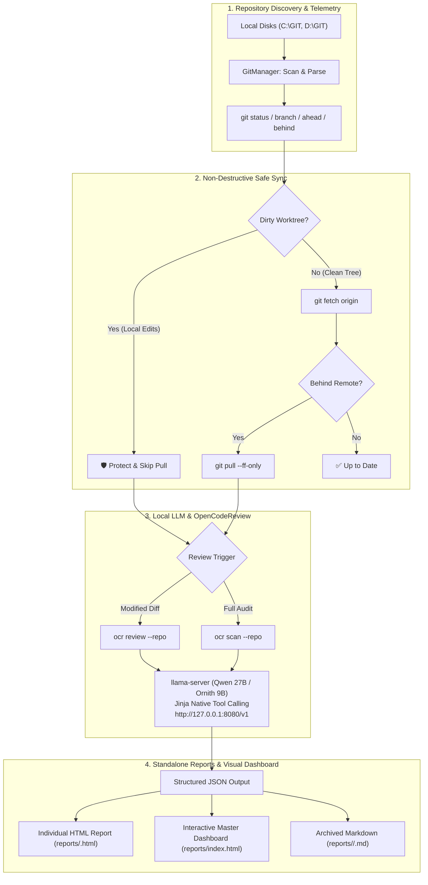

# Git OCR Hub 🔍🚀

[](https://www.python.org/)
[](https://github.com/alibaba/open-code-review)
[](https://github.com/ggml-org/llama.cpp)
[](#-privacy--zero-cloud-guarantee)
[](LICENSE)

> **Multi-repository Git workspace supervisor and local AI code review orchestrator powered by `llama.cpp` and OpenCodeReview (`@alibaba-group/open-code-review`).**

[English](README.md) | [Français](README.fr.md)

**Git OCR Hub** monitors your entire Git portfolio across multiple local drives (e.g., `C:\GIT` and `D:\GIT`), performs non-destructive background fetches and fast-forward synchronizations without risking dirty worktrees, and orchestrates deep local AI code reviews—both for pending diffs and full repository scans—using native LLM function tool calling on consumer hardware.

---

## 🌟 Highlights

- **Multi-Drive Workspace Supervision**: Automatically discovers and tracks dozens of repositories across multiple disk roots (`C:\GIT`, `D:\GIT`). Real-time branch detection, uncommitted change counters, and remote ahead/behind telemetry.
- **Strictly Non-Destructive Git Sync**: Runs `git fetch` on tracked remotes and performs `git pull --ff-only` exclusively on pristine branches. Any repository with local edits or merge conflicts is automatically shielded and reported.
- **Two Review Modes Powered by Local AI**:
  - **Diff Review (`review`)**: Targets active working tree modifications or specific commits (`--commit <hash>`).
  - **Full Audit Scan (`scan`)**: Audits complete repositories or subpaths without requiring git diffs—detecting architectural bugs, security flaws, recursion issues, and resource leaks.
- **Native Tool Calling Integration**: Connects OpenCodeReview with `llama-server` via local OpenAI API endpoints (`http://127.0.0.1:8080/v1`). Models utilize Jinja function calling (`file_find`, `code_search`, `code_comment`, `task_done`) to autonomously investigate source trees.
- **Standalone Visual Reports & Interactive Master Dashboard**:
  - **Master Dashboard (`reports/index.html`)**: Responsive web view with live search, filtering (Dirty, Behind, Clean), and aggregate statistics.
  - **Dedicated Per-Repository HTML Reports (`reports/<repo_name>.html`)**: Clean visual badges, git commit records, and syntax-highlighted AI review findings.
  - **Archived Markdown Audits (`reports/<repo>/<timestamp>.md`)**: Persistent versioned records suitable for documentation and CI logs.
  - **Official OCR Viewer Integration (`ocr viewer`)**: One-click launcher for the official web viewer on `http://localhost:5483`.
- **Zero External Python Dependencies**: Built entirely upon the Python 3 standard library (`subprocess`, `urllib.request`, `json`, `html`, `argparse`). No heavy virtual environment required for core orchestration.
- **Multiple Interfaces**: Command-line Python orchestrator (`orchestrator.py`), interactive PowerShell terminal manager (`run-hub.ps1`), and a double-click Windows runner (`start.bat`).

---

## 🏛️ Architecture Workflow



---

## 🔒 Privacy & Zero Cloud Guarantee

All code analysis runs **100% locally on your machine**:
- **No data leaves your local network**: Prompts, ASTs, file paths, and git diffs are processed directly by your GPU/CPU via `llama-server`.
- **Compatible with air-gapped environments**: Can be fully operated without an internet connection once models and dependencies are downloaded.
- **No subscription or API rate limits**: Unlimited repository reviews powered by open-weights models (e.g., Qwen 2.5/3, Ornith, DeepSeek, or Llama 3).

---

## 🛠️ Prerequisites

1. **Python 3.10+** (standard library only; no pip dependencies required for `orchestrator.py`).
2. **OpenCodeReview CLI**:
   ```bash
   npm install -g @alibaba-group/open-code-review@latest
   ```
3. **Local LLM Runner (`llama.cpp`)**:
   - Install `llama-server` via Winget (`winget install ggml.llamacpp`) or download official release binaries.
   - Recommended model: **Qwen 27B** (e.g. `Qwen3.8-27B-Uncensored` or `Qwen2.5-Coder-32B`) for complex multi-tool calling, or compact models like **Ornith 9B** for fast diff evaluations.

---

## 🚀 Quick Start

### 1. Start the Local LLM Server

Launch `llama-server` configured with Jinja tool-calling and your model of choice:

```powershell
# Using the bundled helper script (configured for AMD/NVIDIA GPUs):
powershell -File C:\Modeles_LLM\start-ocr-local.ps1 -Model Qwen-27B

# Or run llama-server directly:
llama-server -m "D:\Modeles_LLM\Qwen3.8-27B-Uncensored-IQ3_M.gguf" `
  -c 32768 -ctk q4_0 -ctv q4_0 -ngl 99 `
  --flash-attn on --reasoning-budget 512 `
  --port 8080 --jinja --alias "Qwen 27B Uncensored (D:)"
```

Test your setup anytime with:
```bash
ocr llm test
```

### 2. Interactive Terminal Hub

Run the interactive PowerShell menu to manage all operations:

```powershell
.\run-hub.ps1
```

```text
==========================================================
                Git OCR Hub - Main Menu                   
==========================================================
  Local LLM Server : [ ONLINE (Port 8080) ]
----------------------------------------------------------
  1. Show status of all repositories (status)
  2. Sync clean repositories (sync : fetch + pull FF)
  3. AI Diff Review on modified working trees (review)
  4. Full audit of a complete repository without diff (scan)
  5. Full pipeline (sync + review + open dashboard)
  6. Open HTML Dashboard in browser (dashboard)
  7. Start local LLM server (Qwen-27B / llama-server)
  8. Launch OpenCodeReview official WebUI (ocr viewer)
  Q. Quit
==========================================================
```

Or double-click [`start.bat`](start.bat) in Windows Explorer to launch immediately.

---

## 💻 CLI Usage Guide

### Python Orchestrator (`orchestrator.py`)

```bash
# Check status of all monitored repositories
python orchestrator.py status

# Safe fast-forward synchronization of clean repositories
python orchestrator.py sync

# Review modified repositories or target a specific repository
python orchestrator.py review --repo "C:\GIT\my-app" --open

# Review a specific commit
python orchestrator.py review --repo "C:\GIT\my-app" --commit "a1b2c3d" --open

# Full repository audit scan (no git diff needed)
python orchestrator.py scan --repo "C:\GIT\blender-ia" --open

# Targeted audit scan on a specific subpath
python orchestrator.py scan --repo "C:\GIT\blender-ia" --path "extension/tools" --open

# Preview files that would be scanned without calling the LLM
python orchestrator.py scan --repo "C:\GIT\blender-ia" --preview

# Run full routine (sync, review dirty worktrees, generate & open dashboard)
python orchestrator.py all --open
```

### PowerShell Command Mode (`run-hub.ps1`)

```powershell
# Inspect repository states
.\run-hub.ps1 status

# Fast-forward pull clean trees
.\run-hub.ps1 sync

# Launch diff review
.\run-hub.ps1 review

# Launch full audit scan and display report
.\run-hub.ps1 scan -Repo "C:\GIT\blender-ia" -OpenDashboard

# Full sync + review + dashboard
.\run-hub.ps1 all -OpenDashboard

# Open the HTML Dashboard
.\run-hub.ps1 dashboard
```

---

## ⚙️ Configuration (`config.json`)

Configure monitored root directories, repository exclusions, and server endpoints in [`config.json`](config.json):

```json
{
  "monitored_paths": [
    "C:\\GIT",
    "D:\\GIT"
  ],
  "excluded_repos": [
    "git-ocr-hub"
  ],
  "llm_server": {
    "url": "http://127.0.0.1:8080/v1",
    "provider": "local_llama",
    "model": "Qwen 27B Uncensored (D:)",
    "start_script": "C:\\Modeles_LLM\\start-ocr-local.ps1",
    "auto_start": false
  },
  "review_settings": {
    "auto_pull_clean": true,
    "review_on_new_commits": true,
    "review_dirty_worktrees": true,
    "max_files_per_review": 10,
    "format": "json"
  },
  "reports": {
    "output_dir": "reports",
    "keep_history_days": 30
  }
}
```

---

## 📁 Repository Structure

```text
git-ocr-hub/
├── config.json              # Monitored directory paths, LLM endpoint & review rules
├── orchestrator.py          # Core Python orchestrator (Standard Library only)
├── run-hub.ps1              # Interactive and scriptable PowerShell management hub
├── start.bat                # Windows double-click desktop launcher
├── requirements.txt         # Environment instructions and toolchain guide
├── README.md                # English documentation
├── README.fr.md             # Documentation en français
├── core/
│   ├── git_manager.py       # Multi-repo discovery, status inspection & FF pull
│   ├── ocr_runner.py        # OpenCodeReview CLI runner & llama-server bridge
│   └── reporter.py          # Markdown archiver, per-repo HTML & Master Dashboard
└── reports/
    ├── index.html           # Standalone interactive Master Dashboard
    ├── <repo_name>.html     # Per-repository dedicated HTML reports
    └── <repo_name>/         # Timestamped Markdown audit history (.md)
```

---

## 🤝 Contributing

Contributions, feature requests, and bug reports are welcome!
1. Fork the project.
2. Create your feature branch (`git checkout -b feat/amazing-feature`).
3. Commit your changes (`git commit -m 'feat: add amazing feature'`).
4. Push to the branch (`git push origin feat/amazing-feature`).
5. Open a Pull Request.

---

## 📄 License

This project is licensed under the [MIT License](LICENSE).
